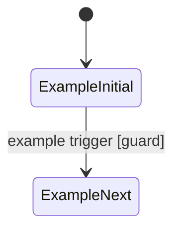

# SM-### — [Business name]

## Identity and purpose

- Modeled concept:
- Aggregate / owner:
- Bounded context:
- Business purpose:
- Classification: EXPLICIT / IMPLICIT / PARTIALLY_SPECIFIED / CANDIDATE
- State dimensions:
- Initial state:
- Terminal states:
- Source references (mandatory registered `SRC-###` ids; e.g. `[SRC-001, §x, p. y]` or
  `[SRC-001, PAR-014]`; paragraph locators must use `PAR-###`, never the paragraph glyph):

## State inventory

| State ID | Name | Category | Business Meaning | Evidence (`SRC-###` citations required) |
|---|---|---|---|---|

## State definitions

### ST-### — [State name]

- Meaning:
- Entry conditions:
- Exit conditions:
- Permitted operations:
- Forbidden operations:
- State invariants:
- Incoming transitions:
- Outgoing transitions:
- Business consequences:
- Classification:
- Evidence:

## Transition table

| Transition ID | From | Trigger / Command / Event | Guard | Actor / Process | To | Events Emitted | Rejection / Failure | Evidence (`SRC-###` citations required) |
|---|---|---|---|---|---|---|---|---|

## Forbidden and unspecified transitions

| From | Trigger / Attempt | Classification (FORBIDDEN / UNSPECIFIED / AMBIGUOUS / CANDIDATE) | Evidence / Reason (`SRC-###` citations required) |
|---|---|---|---|

## Invariants

| Invariant ID | Statement | Category | Scope | Applies To | Evidence (`SRC-###` citations required) |
|---|---|---|---|---|---|

## Mermaid diagram

Replace illustrative states and transitions with source-backed findings. Do not leave example placeholders in a delivered model.

## Completeness review

- Initial state identified:
- Reachability:
- Unreachable states:
- Dead ends:
- Terminal semantics:
- Missing transitions:
- Guard overlap:
- Contradictions:
- Timeout / cancellation / recovery gaps:
- Questions for domain experts:
